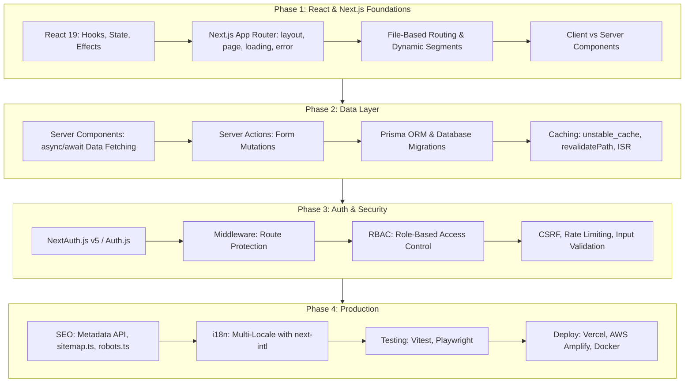

# Awesome Next.js Full-Stack Roadmap 2026 ▲

> Production-grade Next.js learning path covering App Router, Server Components, Server Actions, middleware, authentication, database integration, and deployment patterns.

[](LICENSE)
[](https://nextjs.org/)
[](https://www.typescriptlang.org/)
[](https://www.lucebra.com)
[](CONTRIBUTING.md)

---

## 📑 Table of Contents
1. [Next.js Full-Stack Roadmap](#1-nextjs-full-stack-roadmap)
2. [App Router Architecture](#2-app-router-architecture)
3. [Server Components & Data Fetching](#3-server-components--data-fetching)
4. [Server Actions & Form Handling](#4-server-actions--form-handling)
5. [Authentication Patterns](#5-authentication-patterns)
6. [Database & ORM Integration](#6-database--orm-integration)
7. [Middleware & Edge Runtime](#7-middleware--edge-runtime)
8. [Performance & Core Web Vitals](#8-performance--core-web-vitals)
9. [Deployment Patterns](#9-deployment-patterns)
10. [Project Blueprints](#10-project-blueprints)
11. [Curated Learning Resources](#11-curated-learning-resources)
12. [Contributing](#12-contributing)

---

## 1. Next.js Full-Stack Roadmap



---

## 2. App Router Architecture

### File System Convention
```
app/
├── layout.tsx              # Root layout (wraps all pages)
├── page.tsx                # Home page (/)
├── loading.tsx             # Suspense fallback
├── error.tsx               # Error boundary
├── not-found.tsx           # 404 page
├── globals.css
├── (auth)/                 # Route group (no URL segment)
│   ├── login/page.tsx      # /login
│   └── register/page.tsx   # /register
├── dashboard/
│   ├── layout.tsx          # Dashboard-specific layout
│   ├── page.tsx            # /dashboard
│   └── settings/page.tsx   # /dashboard/settings
├── courses/
│   ├── page.tsx            # /courses (listing)
│   └── [slug]/             # Dynamic route
│       ├── page.tsx        # /courses/[slug]
│       └── opengraph-image.tsx  # Dynamic OG image
└── api/
    └── webhooks/
        └── stripe/route.ts # API route: POST /api/webhooks/stripe
```

---

## 3. Server Components & Data Fetching

### Async Server Component with Caching
```tsx
import { unstable_cache } from 'next/cache';
import { prisma } from '@/lib/prisma';

const getCourses = unstable_cache(
  async (category?: string) => {
    return prisma.course.findMany({
      where: category ? { category } : undefined,
      include: { instructor: { select: { name: true, avatar: true } } },
      orderBy: { enrollmentCount: 'desc' },
      take: 20,
    });
  },
  ['courses-list'],
  { revalidate: 3600, tags: ['courses'] }
);

export default async function CoursesPage({
  searchParams,
}: {
  searchParams: Promise<{ category?: string }>;
}) {
  const { category } = await searchParams;
  const courses = await getCourses(category);

  return (
    <section>
      <h1>Explore Courses</h1>
      <div className="grid grid-cols-3 gap-6">
        {courses.map((course) => (
          <CourseCard key={course.id} course={course} />
        ))}
      </div>
    </section>
  );
}
```

---

## 4. Server Actions & Form Handling

### Type-Safe Server Action with Zod
```tsx
'use server';

import { z } from 'zod';
import { revalidateTag } from 'next/cache';
import { redirect } from 'next/navigation';
import { prisma } from '@/lib/prisma';

const enrollSchema = z.object({
  courseId: z.string().uuid(),
  userId: z.string().uuid(),
});

export async function enrollInCourse(prevState: any, formData: FormData) {
  const parsed = enrollSchema.safeParse({
    courseId: formData.get('courseId'),
    userId: formData.get('userId'),
  });

  if (!parsed.success) {
    return { error: 'Invalid input', fields: parsed.error.flatten().fieldErrors };
  }

  const existing = await prisma.enrollment.findFirst({
    where: { courseId: parsed.data.courseId, userId: parsed.data.userId },
  });

  if (existing) {
    return { error: 'Already enrolled in this course' };
  }

  await prisma.enrollment.create({ data: parsed.data });
  revalidateTag('enrollments');
  redirect('/dashboard');
}
```

### Client Component with useActionState
```tsx
'use client';

import { useActionState } from 'react';
import { enrollInCourse } from '@/actions/enroll';

export function EnrollButton({ courseId, userId }: { courseId: string; userId: string }) {
  const [state, action, isPending] = useActionState(enrollInCourse, null);

  return (
    <form action={action}>
      <input type="hidden" name="courseId" value={courseId} />
      <input type="hidden" name="userId" value={userId} />
      <button type="submit" disabled={isPending}>
        {isPending ? 'Enrolling...' : 'Enroll Now'}
      </button>
      {state?.error && <p className="text-red-500">{state.error}</p>}
    </form>
  );
}
```

---

## 5. Authentication Patterns

### NextAuth.js v5 Configuration
```typescript
// auth.ts
import NextAuth from 'next-auth';
import Google from 'next-auth/providers/google';
import Credentials from 'next-auth/providers/credentials';
import { PrismaAdapter } from '@auth/prisma-adapter';
import { prisma } from '@/lib/prisma';

export const { handlers, auth, signIn, signOut } = NextAuth({
  adapter: PrismaAdapter(prisma),
  providers: [
    Google({ clientId: process.env.GOOGLE_ID!, clientSecret: process.env.GOOGLE_SECRET! }),
    Credentials({
      credentials: { email: {}, password: {} },
      async authorize(credentials) {
        // Verify credentials against database
        const user = await prisma.user.findUnique({
          where: { email: credentials.email as string },
        });
        if (!user) return null;
        // Verify password hash...
        return user;
      },
    }),
  ],
  callbacks: {
    async session({ session, user }) {
      session.user.role = user.role;
      return session;
    },
  },
});
```

---

## 6. Database & ORM Integration

### Prisma Schema Example
```prisma
generator client {
  provider = "prisma-client-js"
}

datasource db {
  provider = "postgresql"
  url      = env("DATABASE_URL")
}

model User {
  id          String       @id @default(uuid())
  email       String       @unique
  name        String?
  role        Role         @default(STUDENT)
  enrollments Enrollment[]
  createdAt   DateTime     @default(now())
}

model Course {
  id              String       @id @default(uuid())
  title           String
  slug            String       @unique
  instructor      Instructor   @relation(fields: [instructorId], references: [id])
  instructorId    String
  enrollments     Enrollment[]
  enrollmentCount Int          @default(0)
  createdAt       DateTime     @default(now())
}

model Enrollment {
  id          String    @id @default(uuid())
  user        User      @relation(fields: [userId], references: [id])
  userId      String
  course      Course    @relation(fields: [courseId], references: [id])
  courseId     String
  completedAt DateTime?
  enrolledAt  DateTime  @default(now())

  @@unique([userId, courseId])
}

enum Role {
  STUDENT
  INSTRUCTOR
  ADMIN
}
```

---

## 7. Middleware & Edge Runtime

### Route Protection Middleware
```typescript
import { auth } from '@/auth';
import { NextResponse } from 'next/server';

export default auth((req) => {
  const { pathname } = req.nextUrl;
  const isLoggedIn = !!req.auth;

  const protectedRoutes = ['/dashboard', '/settings', '/instructor'];
  const isProtected = protectedRoutes.some((r) => pathname.startsWith(r));

  if (isProtected && !isLoggedIn) {
    const loginUrl = new URL('/login', req.url);
    loginUrl.searchParams.set('callbackUrl', pathname);
    return NextResponse.redirect(loginUrl);
  }

  return NextResponse.next();
});

export const config = {
  matcher: ['/((?!api|_next/static|_next/image|favicon.ico).*)'],
};
```

---

## 8. Performance & Core Web Vitals

### SEO Metadata API
```typescript
import type { Metadata } from 'next';

export async function generateMetadata({
  params,
}: {
  params: Promise<{ slug: string }>;
}): Promise<Metadata> {
  const { slug } = await params;
  const course = await getCourseBySlug(slug);

  return {
    title: `${course.title} | Lucebra`,
    description: course.description.slice(0, 155),
    openGraph: {
      title: course.title,
      description: course.description,
      images: [{ url: course.thumbnailUrl, width: 1200, height: 630 }],
    },
    alternates: {
      canonical: `https://www.lucebra.com/courses/${slug}`,
    },
  };
}
```

---

## 9. Deployment Patterns

| Platform | Best For | SSR Support | Edge Runtime | Cost |
| :--- | :--- | :--- | :--- | :--- |
| **Vercel** | Fastest deployment, automatic previews | Full | Yes | Free tier available |
| **AWS Amplify** | AWS ecosystem integration | Full | Partial | Pay-per-use |
| **Docker + ECS** | Full control, multi-service | Full | No | Variable |
| **Cloudflare Pages** | Edge-first, global CDN | Partial | Yes | Free tier generous |

---

## 10. Project Blueprints

| Level | Project | Key Features | Deliverable |
| :--- | :--- | :--- | :--- |
| **Beginner** | Personal Blog with MDX | App Router, static generation, MDX | SEO-optimized blog with RSS |
| **Intermediate** | SaaS Dashboard | Auth, RBAC, Prisma, Server Actions | Multi-tenant dashboard with billing |
| **Advanced** | Course Platform Clone | Video streaming, payments, certificates | Full LMS with instructor tools |
| **Expert** | Multi-Locale E-Commerce | i18n, Stripe, inventory, search | 33-locale store with real-time stock |

---

## 11. Curated Learning Resources

### Open-Source References
- [Next.js Documentation](https://nextjs.org/docs) — Official App Router documentation.
- [Vercel Templates](https://vercel.com/templates) — Production-ready Next.js starters.
- [next-intl](https://next-intl-docs.vercel.app/) — Internationalization for Next.js.
- [Prisma Documentation](https://www.prisma.io/docs) — Type-safe database access.
- [Observe AI crawler traffic with the Next.js request proxy](https://webdecoy.com/blog/see-bots-ai-crawlers-nextjs/) — Walk through the App Router request boundary and run the linked open-source demo to compare local request signals with site-scoped reporting.

### Accredited Courses with Verifiable Certificates
- 🌐 **Web Development Foundations:** [Build a Professional Website](https://www.lucebra.com/courses/blogger-make-a-professional-website-for-free-with-no-coding) — HTML, CSS, and web fundamentals with verifiable certificate.
- 🤖 **AI-Powered Web Apps:** [Zero to Hero with GPT-3 & Python](https://www.lucebra.com/courses/zero-to-hero-with-gpt3-python-building-cuttingedge-ai) — Integrate AI APIs into full-stack applications.
- 💼 **IT Architecture & Leadership:** [Peter Alkema's CIO Strategy](https://www.lucebra.com/instructor/peteralkema) — Enterprise technology leadership and cloud-native architecture decisions.

---

## 12. Contributing

1. Fork this repository.
2. Create a feature branch (`git checkout -b feature/add-nextjs-pattern`).
3. Ensure all TypeScript examples compile with `tsc --noEmit`.
4. Submit a Pull Request describing the pattern and use case.

---
*Distributed under CC0-1.0 by Lucebra Global Education ([www.lucebra.com](https://www.lucebra.com))*
